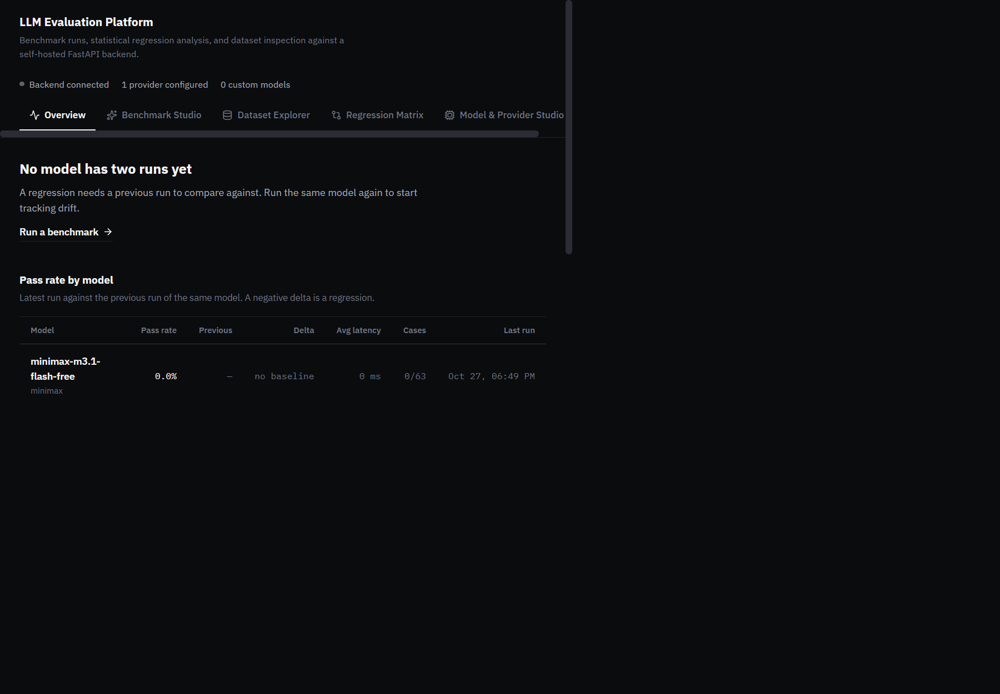
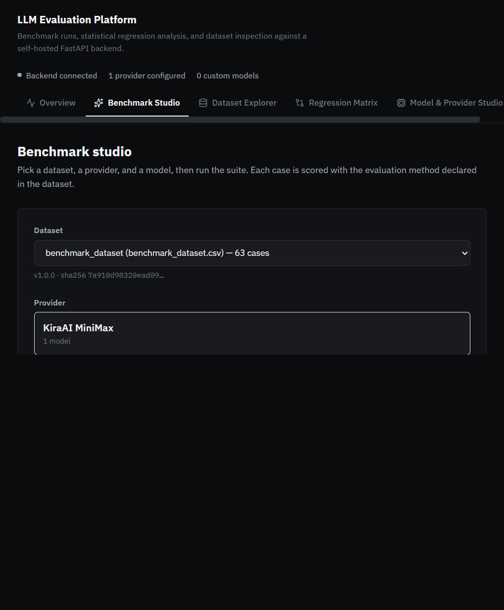
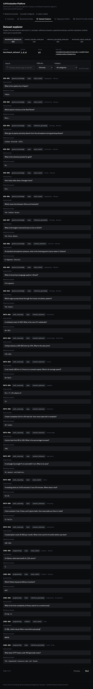
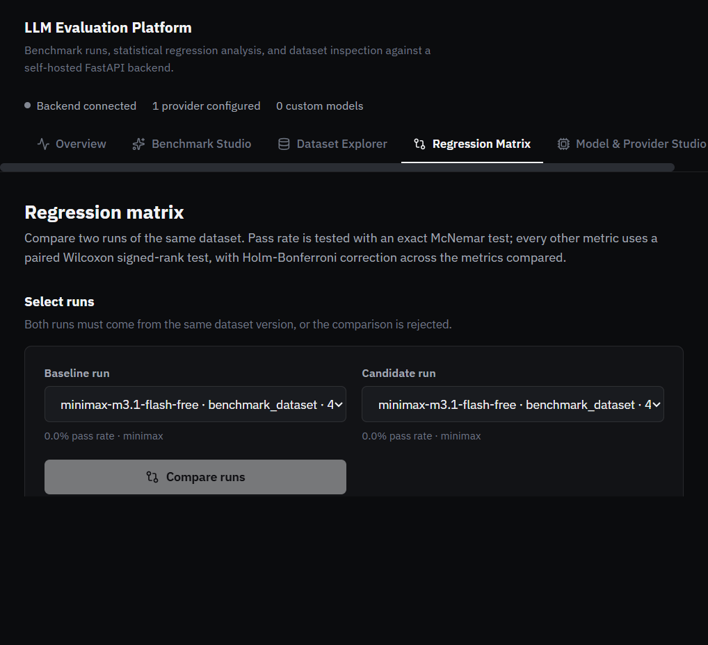
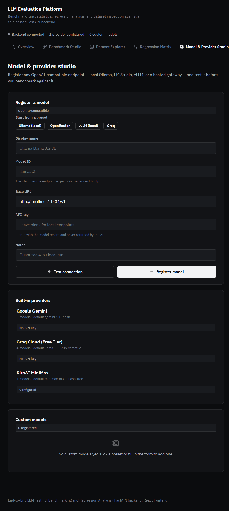
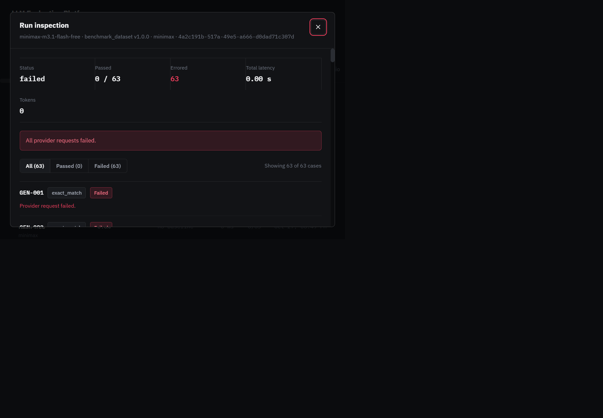
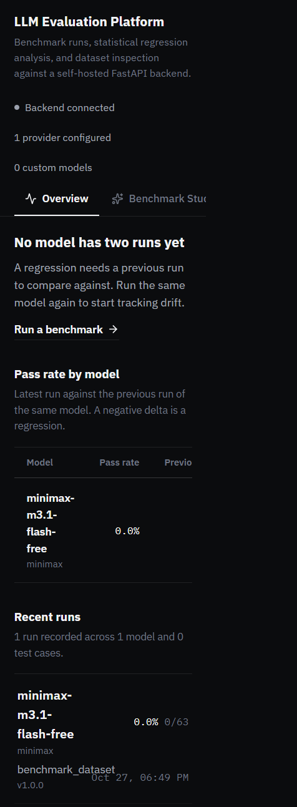

# Project Documentation

**End-to-End LLM Testing, Benchmarking and Regression Analysis**

A self-hosted platform for running reproducible LLM benchmark suites, scoring each response with deterministic and model-graded evaluators, and detecting statistically significant regressions between two runs of the same dataset.

---

## Table of contents

1. [Executive summary](#1-executive-summary)
2. [Problem statement and scope](#2-problem-statement-and-scope)
3. [System architecture](#3-system-architecture)
4. [Technology stack](#4-technology-stack)
5. [Repository layout](#5-repository-layout)
6. [Backend modules](#6-backend-modules)
7. [Evaluation core](#7-evaluation-core)
8. [Provider layer](#8-provider-layer)
9. [API reference](#9-api-reference)
10. [Database schema](#10-database-schema)
11. [Frontend architecture](#11-frontend-architecture)
12. [Design system](#12-design-system)
13. [Datasets](#13-datasets)
14. [Legacy Streamlit dashboard](#14-legacy-streamlit-dashboard)
15. [Configuration](#15-configuration)
16. [Setup and installation](#16-setup-and-installation)
17. [Running the application](#17-running-the-application)
18. [Testing](#18-testing)
19. [Security model](#19-security-model)
20. [Known limitations and future work](#20-known-limitations-and-future-work)

---

## 1. Executive summary

This platform answers one question with statistical rigour: **did this model get worse?**

Most LLM evaluation tooling reports a score. A score alone cannot tell you whether a change is real or noise, and it cannot tell you whether a drop is large enough to act on. This project closes that gap by pairing a benchmark runner with a paired statistical comparison engine.

The system has three parts:

| Part | Role | Entry point |
|---|---|---|
| **Backend** | Runs benchmarks, scores cases, performs regression analysis, persists everything | `backend/main.py` |
| **Frontend** | React SPA for launching runs, inspecting cases, and reading the regression matrix | `frontend/src/App.tsx` |
| **Legacy dashboard** | Streamlit UI over the same API, retained for parity | `dashboard/app.py` |

The core design commitments are:

- **Reproducibility.** Every run records the dataset's SHA-256. Two runs can only be compared when their dataset hashes match, so a comparison can never silently mix different test suites.
- **Fail-closed evaluation.** An unrecognised evaluation method raises rather than passing. A case is never marked correct by accident.
- **Honest statistics.** Pass rate uses an exact McNemar test; every other metric uses a paired Wilcoxon signed-rank test. Confidence intervals come from a paired percentile bootstrap with a fixed, SHA-256-derived seed. Multiple comparisons are corrected with Holm-Bonferroni.
- **No fabricated data.** The UI renders only what the API returns. Where a value is unavailable, it says so rather than showing a placeholder number.

---

## 2. Problem statement and scope

### The problem

A team changes a prompt template, swaps a model version, or adjusts a decoding parameter. The new configuration scores 84% where the old one scored 87%. Three questions follow immediately:

1. Is a three-point drop larger than run-to-run noise?
2. Which specific metrics moved, and by how much?
3. Which test cases actually changed verdict?

Answering these by eye is unreliable. With 63 test cases, a three-point swing is two cases — well inside the range that random sampling produces. Acting on it wastes effort; ignoring it risks shipping a real regression.

### What this project does

- Executes a benchmark suite against any OpenAI-compatible endpoint.
- Scores each case with a deterministic evaluator, and optionally with semantic similarity and an LLM judge.
- Stores every case result, including failures, with a sanitized error category.
- Compares two runs of the same dataset and reports, per metric, the mean delta, a bootstrap confidence interval, a raw p-value, a Holm-Bonferroni adjusted p-value, and a boolean regression verdict.
- Presents the result as a matrix where a regression is the visually dominant signal.

### What this project deliberately does not do

- **No automatic prompt optimisation.** The platform measures; it does not tune.
- **No hosted multi-tenant service.** It is designed to run on one machine or one container, against your own API keys.
- **No database migrations.** Schema is created from the SQLAlchemy models at import. Changing a model requires recreating the database.
- **No streaming responses.** Providers are called with a single request/response cycle.

---

## 3. System architecture


The architecture is a straight line: the browser talks to FastAPI, FastAPI orchestrates the evaluation core, the evaluation core calls providers over HTTP, and everything durable lands in SQLite.

**Request path.** Every request passes a middleware chain before reaching a route handler:

1. `CORSMiddleware` — origins from `CORS_ORIGINS`.
2. `TrustedHostMiddleware` — applied only when `ENVIRONMENT=production`.
3. `protect_api` — a custom HTTP middleware that enforces the `x-api-key` header when `BACKEND_API_KEY` is set, and rejects bodies larger than 1 MiB.

**Orchestration.** `runner.execute_run()` is the only place that drives a full benchmark. It loads the dataset, creates the run row, iterates cases, calls the provider, dispatches to the evaluators, and commits progress after each case. Committing per case means a crash mid-run leaves an inspectable, partially complete record rather than nothing.


**Analysis.** `analysis.compare_runs()` is pure with respect to the network: it reads two runs' case results from the database, pairs them by `test_case_id`, and computes the comparison. It never calls a provider.


**Persistence.** SQLAlchemy 2.0 declarative models over SQLite. Four tables, described in [section 10](#10-database-schema).


---

## 4. Technology stack

### Backend

| Component | Version constraint | Purpose |
|---|---|---|
| Python | `>=3.11` | Runtime |
| FastAPI | — | HTTP API and request validation |
| Uvicorn | — | ASGI server |
| SQLAlchemy | 2.0 style | ORM and schema definition |
| Pydantic | — | Request/response and judge scorecard validation |
| httpx | — | Async provider HTTP client |
| NumPy | — | Bootstrap resampling |
| SciPy | — | McNemar and Wilcoxon tests |
| scikit-learn | — | Cosine similarity |
| sentence-transformers | — | Semantic similarity embeddings |
| jsonschema | — | `json_schema_validation` evaluator |
| pandas | — | CSV dataset loading |
| python-dotenv | — | `.env` loading |
| Streamlit | — | Legacy dashboard |
| Plotly | — | Legacy dashboard charts |

Dev extras: `pytest`, `pytest-cov`, `ruff` (line length 100, rules `E`, `F`, `I`).

### Frontend

| Component | Version | Purpose |
|---|---|---|
| React | 19 | UI |
| TypeScript | — | Type safety |
| Vite | 8 | Dev server and production bundler |
| oxlint | — | Linting |
| lucide-react | — | Icon set |

The frontend has no state-management library, no CSS framework, and no component library. State lives in `App.tsx` and is passed down as props. Styling is a single hand-written stylesheet, `index.css`.

---

## 5. Repository layout

```
.
├── backend/
│   ├── main.py                     FastAPI app, middleware, all routes
│   ├── config.py                   Frozen Settings dataclass, production guards
│   ├── database.py                 Engine, session factory, Base
│   ├── models.py                   Four SQLAlchemy tables
│   ├── __main__.py                 `python -m backend` entry point
│   ├── evaluation/
│   │   ├── runner.py               execute_run — the orchestration loop
│   │   ├── metrics.py              evaluate_case — deterministic evaluators
│   │   ├── semantic.py             SemanticScorer — embedding similarity
│   │   ├── judge.py                LLM judge with a strict scorecard
│   │   ├── analysis.py             compare_runs — the regression engine
│   │   ├── datasets.py             load_dataset + SHA-256
│   │   ├── schemas.py              Case-level result schemas
│   │   ├── run_schemas.py          Run request/response schemas
│   │   └── analysis_schemas.py     Comparison schemas
│   └── providers/
│       ├── base.py                 Provider protocol, retry policy, error mapping
│       ├── factory.py              create_configured_providers
│       ├── gemini.py               Google Gemini
│       ├── groq.py                 Groq Cloud
│       ├── minimax.py              KiraAI MiniMax
│       ├── custom.py               User-registered OpenAI-compatible endpoints
│       ├── mock.py                 Deterministic test provider
│       └── models.py               Provider-side data models
├── frontend/
│   ├── src/
│   │   ├── App.tsx                 Shell, tab routing, polling, modal state
│   │   ├── api.ts                  All API types and fetch functions
│   │   ├── index.css               Design tokens and every component class
│   │   ├── main.tsx                React root
│   │   └── components/
│   │       ├── Header.tsx          Brand, status row, navigation
│   │       ├── OverviewView.tsx    Verdict, regression matrix, run ledger
│   │       ├── BenchmarkStudioView.tsx   Launch a run
│   │       ├── DatasetExplorerView.tsx   Browse and filter cases
│   │       ├── RegressionMatrixView.tsx  Compare two runs
│   │       ├── ModelStudioView.tsx       Register and test endpoints
│   │       └── RunDetailModal.tsx        Per-case inspection dialog
│   ├── vite.config.ts              Dev server and API proxy
│   └── package.json
├── dashboard/
│   └── app.py                      Legacy Streamlit dashboard
├── datasets/
│   ├── manifest.json               SHA-256 and byte size for every dataset
│   ├── benchmark_dataset.csv       63 cases, 10 columns
│   ├── prompt_injection_tests.json 20 cases
│   ├── reference_grounding_tests.json 20 cases
│   └── structured_output_tests.json 20 cases
├── tests/                          8 test modules, 54 passing tests
├── docs/
│   ├── PROJECT_DOCUMENTATION.md    This document
│   ├── PROJECT_DOCUMENTATION.docx  Word version
│   ├── ARCHITECTURE.md             Earlier architecture note
│   ├── DEPLOYMENT.md               Deployment guide
│   ├── GITHUB_WORKFLOW.md          CI notes
│   └── diagrams/                   12 Mermaid source files
├── pyproject.toml
├── compose.yaml
└── .env.example
```

---

## 6. Backend modules

### `backend/config.py`

A frozen dataclass holding every setting, populated from environment variables via `python-dotenv`. Being frozen means configuration cannot drift at runtime.

Production guards raise at import time rather than failing later:

- `BACKEND_API_KEY` must be set when `ENVIRONMENT=production`.
- `CORS_ORIGINS` must not contain a wildcard in production.
- Debug affordances are disabled.

### `backend/database.py`

Creates the SQLAlchemy engine, a `sessionmaker`, and the declarative `Base`. `Base.metadata.create_all(bind=engine)` runs at import, so the schema is created on first start. There is no migration system.

### `backend/models.py`

Four tables: `benchmark_runs`, `benchmark_case_results`, `run_analyses`, `custom_models`. See [section 10](#10-database-schema).

### `backend/main.py`

The application. Responsibilities:

- Builds the FastAPI app with `docs_url`, `redoc_url`, and `openapi_url` all set to `None` in production, so the schema is not exposed.
- Installs the middleware chain described in [section 3](#3-system-architecture).
- Defines every route. Handlers are thin: they validate input, call into the evaluation core, and serialise the result.
- Owns the `protect_api` middleware, which uses `hmac.compare_digest` for the API-key comparison so the check is not timing-sensitive.

---

## 7. Evaluation core

### `evaluation/datasets.py`

`load_dataset()` reads a CSV or JSON file from `datasets/`, normalises each row into a case dictionary, and computes the file's SHA-256. The hash is the reproducibility anchor: it is stored on the run and checked before any comparison.


### `evaluation/metrics.py`

`evaluate_case()` implements exactly three deterministic methods:

| Method | Behaviour |
|---|---|
| `exact_match` | Normalised string equality against `reference_answer` |
| `numeric_tolerance` | Parses both values as floats and compares within a tolerance |
| `json_schema_validation` | Validates the candidate against `expected_output_schema` with `jsonschema` |

Any other method raises `ValueError`. This is deliberate: an unknown method must never be treated as a pass.

### `evaluation/semantic.py`

`SemanticScorer` wraps `sentence-transformers` behind an `lru_cache(2)` so at most two models are resident. It returns cosine similarity between the candidate and the reference answer.

Two properties matter:

- Cosine similarity is **not** a correctness probability. It measures textual proximity. A confidently wrong answer that paraphrases the reference can score highly.
- When either text is missing, similarity is `None` rather than zero, so absence is distinguishable from dissimilarity.

### `evaluation/judge.py`

An LLM-as-judge evaluator with a strict Pydantic scorecard. Five dimensions are scored on a 1–5 scale: relevance, completeness, instruction following, factual alignment, and clarity. `factual_alignment` is optional when the case supplies no reference context — scoring it without a ground truth would be fabrication.

The rubric is versioned as `llm-judge-rubric-v1`, and that version is recorded with the result so scores remain interpretable if the rubric later changes.

### `evaluation/runner.py`

`execute_run()` is the orchestration loop:

1. Load the dataset and compute its hash.
2. Insert a `benchmark_runs` row with `status='running'`.
3. For each case: call the provider, dispatch to the evaluators, insert a `benchmark_case_results` row, and update the run's progress counters — committing after each case.
4. Set the final status.

Final status is derived from the error count:

| Condition | Status |
|---|---|
| Every case errored | `failed` |
| Some cases errored | `partial_failure` |
| No cases errored | `completed` |

### `evaluation/analysis.py`

`compare_runs()` is the regression engine. It validates its inputs strictly:

- Both runs must share the same `dataset_sha256`.
- The run ids must differ.
- `0 < alpha < 1`.
- `minimum_regression_drop >= 0`.

It then extracts eight metrics by pairing case results on `test_case_id`:

`deterministic_pass_rate`, `semantic_similarity`, `judge_overall`, `judge_relevance`, `judge_completeness`, `judge_instruction_following`, `judge_factual_alignment`, `judge_clarity`.

For each metric it computes:

- **Mean delta** between candidate and baseline.
- **Test statistic and p-value.** `deterministic_pass_rate` uses an exact McNemar test on discordant pairs, which is the correct test for paired binary outcomes. Every other metric uses a paired Wilcoxon signed-rank test.
- **Bootstrap confidence interval.** A paired percentile bootstrap with 10,000 resamples, seeded from a SHA-256 digest so the interval is reproducible.
- **Holm-Bonferroni adjusted p-value**, correcting across all metrics compared in the same call.
- **Regression verdict:** `adjusted_p < alpha AND mean_delta < -minimum_regression_drop`.

Both conditions are required. A statistically significant but tiny drop is not a regression; a large drop with too few samples to be significant is not a regression either.

> **Note on `higher_is_better`.** The field exists on every `MetricComparison` and defaults to `True`. No code path currently sets it to `False`, because every metric the engine extracts is one where a higher value is better. The field is retained so a future cost or latency metric can be added without changing the comparison logic.

---

## 8. Provider layer

### `providers/base.py`

Defines the `Provider` protocol with a single async `generate()` method, plus the shared HTTP machinery:

- **`RetryPolicy`** — exponential backoff computed as `initial_delay_seconds * 2**attempt`, capped at `max_delay_seconds`. A `Retry-After` header is honoured in both numeric-seconds and HTTP-date form.
- **`BaseHttpProvider._send_with_retry`** — retries on 408, 429, and 5xx responses, and on `httpx.TimeoutException` and `httpx.TransportError`.
- **Error mapping** — every failure is classified into one of: `timeout`, `rate_limited`, `upstream_unavailable`, `authentication` (401/403), `request_rejected` (other 4xx), `invalid_response`.
- **Sanitisation** — `ProviderError` messages never include request headers or API keys. This is what makes it safe to persist `error_message` on a case row and display it in the UI.


### `providers/factory.py`

`create_configured_providers()` instantiates only providers whose API key is non-blank. A provider with no key is reported as unconfigured by `GET /api/config/providers` and is never constructed.

### Provider implementations

| Module | Provider | Notes |
|---|---|---|
| `gemini.py` | Google Gemini | Native Gemini API shape |
| `groq.py` | Groq Cloud | OpenAI-compatible |
| `minimax.py` | KiraAI MiniMax | OpenAI-compatible |
| `custom.py` | User-registered | Any OpenAI-compatible base URL |
| `mock.py` | Test double | Deterministic, used by the test suite |

---

## 9. API reference

All routes are under `/api` except the two health probes. When `BACKEND_API_KEY` is set, every `/api` route requires an `x-api-key` header.

### Health

| Method | Path | Returns |
|---|---|---|
| `GET` | `/health` | `{status, app, environment}` |
| `GET` | `/ready` | Readiness probe |

### Configuration

| Method | Path | Returns |
|---|---|---|
| `GET` | `/api/config/providers` | `{providers, custom_models, judge_enabled, judge_provider, environment}` |

Each entry in `providers` is keyed by provider id and carries `{name, configured, default_model, available_models[]}`.

### Custom models

| Method | Path | Purpose |
|---|---|---|
| `GET` | `/api/custom-models` | List registered endpoints |
| `POST` | `/api/custom-models` | Register an endpoint |
| `DELETE` | `/api/custom-models/{id}` | Remove an endpoint |
| `POST` | `/api/custom-models/test` | Send a probe request and report latency |

The API never returns a stored `api_key`.

### Datasets

| Method | Path | Returns |
|---|---|---|
| `GET` | `/api/datasets` | `[{dataset_file, dataset_name, dataset_version, case_count, sha256}]` |
| `GET` | `/api/datasets/{file}/cases` | `{dataset_file, dataset_name, dataset_version, cases[]}` |

### Runs

| Method | Path | Purpose |
|---|---|---|
| `POST` | `/api/runs` | Execute a benchmark synchronously and return the finished `RunSummary` |
| `GET` | `/api/runs` | List runs, newest first |
| `GET` | `/api/runs/{id}` | Run detail including every case result |

`POST /api/runs` body:

```json
{
  "dataset_file": "benchmark_dataset.csv",
  "provider": "minimax",
  "model_id": "minimax-m3.1-flash-free",
  "include_judge": false
}
```

### Analyses

| Method | Path | Purpose |
|---|---|---|
| `POST` | `/api/analyses/compare` | Compare two runs and return the metric matrix |
| `GET` | `/api/analyses` | List stored analyses |
| `GET` | `/api/analyses/{id}` | Retrieve a stored analysis |

`POST /api/analyses/compare` body:

```json
{
  "baseline_run_id": "<uuid>",
  "candidate_run_id": "<uuid>",
  "alpha": 0.05,
  "minimum_regression_drop": 0.02
}
```

### Overview

| Method | Path | Returns |
|---|---|---|
| `GET` | `/api/overview` | `{project, status, metrics: {total_runs, models_evaluated, test_cases_executed}}` |

> **Important.** `/api/overview` returns **no regression data**. The Overview page's verdict line and regression matrix are derived client-side by grouping `GET /api/runs` by `provider::model_id` and comparing each model's latest run against its previous run. This is a deliberate choice: the overview endpoint stays cheap, and the verdict is computed from the same run list the ledger displays, so the two can never disagree.


---

## 10. Database schema


### `benchmark_runs`

One row per benchmark execution.

| Column | Type | Notes |
|---|---|---|
| `id` | string, PK | UUID4 hex |
| `dataset_file` | string | Filename within `datasets/` |
| `dataset_name` | string | Human-readable name |
| `dataset_version` | string | From the dataset |
| `dataset_sha256` | string | **Comparison guard** |
| `provider` | string | Provider id |
| `model_id` | string | Model identifier |
| `status` | string | `running`, `completed`, `partial_failure`, `failed` |
| `judge_enabled` | boolean | Whether the LLM judge ran |
| `started_at` | datetime | Indexed |
| `completed_at` | datetime | Null while running |
| `total_cases` | int | |
| `completed_cases` | int | |
| `passed_cases` | int | |
| `errored_cases` | int | |
| `total_input_tokens` | int | |
| `total_output_tokens` | int | |
| `total_latency_ms` | float | |
| `total_estimated_cost_usd` | float | |
| `error_message` | text | Sanitized summary |

### `benchmark_case_results`

One row per case per run.

| Column | Type | Notes |
|---|---|---|
| `id` | int, PK | |
| `run_id` | string, FK | `ON DELETE CASCADE` |
| `ordinal` | int | Position in the dataset |
| `test_case_id` | string | Unique together with `run_id` |
| `evaluation_method` | string | |
| `status` | string | `passed`, `failed`, `error` |
| `candidate_text` | text | Null when the provider failed |
| `provider`, `model_id` | string | Null when the provider failed |
| `input_tokens`, `output_tokens` | int | |
| `latency_ms` | float | |
| `estimated_cost_usd` | float | |
| `deterministic_result` | JSON | |
| `semantic_result` | JSON | |
| `judge_result` | JSON | |
| `evaluation_error` | text | |
| `error_category` | string | One of the six provider error classes |
| `error_message` | text | Sanitized |

A unique index on `(run_id, test_case_id)` prevents duplicate case rows.

### `run_analyses`

One row per comparison.

| Column | Type | Notes |
|---|---|---|
| `id` | int, PK | |
| `baseline_run_id` | string, FK | |
| `candidate_run_id` | string, FK | |
| `method_version` | string | |
| `alpha` | float | |
| `minimum_regression_drop` | float | |
| `created_at` | datetime | Indexed |
| `result` | JSON | The full metric matrix |

### `custom_models`

| Column | Type | Notes |
|---|---|---|
| `id` | int, PK | |
| `name` | string | Display name |
| `model_id` | string | Identifier sent to the endpoint |
| `base_url` | string | OpenAI-compatible root |
| `api_key` | string | **Never returned by the API** |
| `description` | text | |
| `created_at` | datetime | Indexed |
| `is_active` | boolean | |

---

## 11. Frontend architecture


### Interface

The screenshots below are captured from the running application against the live backend. No mock data is used.

**Overview** — the verdict line, the regression matrix, and the run ledger. The matrix is the first thing in the viewport; the ledger sits below it as dense rows rather than cards.



**Benchmark Studio** — dataset, provider, model, and judge selection. Provider and model lists are read from `GET /api/config/providers`, so only configured providers appear as selectable.



**Dataset Explorer** — case browsing with search, category and difficulty filters, paginated 25 cases per page.



**Regression Matrix** — baseline and candidate selection with the full metric matrix.



**Model & Provider Studio** — register and test any OpenAI-compatible endpoint.



**Run inspection dialog** — per-case results with a status filter. The dialog traps focus, closes on Escape, and restores focus to the row that opened it.



**Overview at 390px** — the matrix scrolls horizontally inside its own container with the model column pinned; the ledger rows collapse to two lines. There is no page-level horizontal overflow.



### State ownership

`App.tsx` owns all application state:

- `activeTab` — which view is mounted.
- `overview`, `providers`, `datasets`, `runs`, `customModels` — server data.
- `isOnline` — whether the backend responded.
- `inspectRunId` — which run the detail modal is showing.

Data is fetched by a single `refreshAllData` callback, wrapped in `useCallback` so the polling effect has a stable dependency. The effect calls it once on mount and then every 10 seconds.

Each fetch is individually `.catch()`-guarded, so one failing endpoint degrades that panel rather than blanking the page.

### Views

| View | Responsibility |
|---|---|
| `OverviewView` | Verdict line, regression matrix, run ledger |
| `BenchmarkStudioView` | Dataset, provider, model, and judge selection; launches a run |
| `DatasetExplorerView` | Browse cases with search, category and difficulty filters, paginated 25 per page |
| `RegressionMatrixView` | Pick a baseline and a candidate run; render the metric matrix |
| `ModelStudioView` | Register, test, and delete custom endpoints |
| `RunDetailModal` | Per-case inspection with a status filter |

### Derived state instead of synchronising effects

Three views need a selection that stays valid as asynchronous data arrives — the dataset in Benchmark Studio, the baseline and candidate runs in Regression Matrix, and the current page in Dataset Explorer.

Rather than seeding these with `useEffect` (which triggers a second render pass and is flagged by the linter), each is **derived during render**:

```tsx
const datasetFile =
  selectedDataset && datasets.some((d) => d.dataset_file === selectedDataset)
    ? selectedDataset
    : datasets[0]?.dataset_file || ''
```

The user's choice is kept while it remains valid and falls back to a sensible default otherwise. There is no window in which the form holds a stale value.

### Accessibility

- `RunDetailModal` sets `role="dialog"`, `aria-modal="true"`, and `aria-labelledby` pointing at its heading.
- Focus is trapped inside the modal while it is open, cycling on Tab and Shift+Tab.
- Escape closes it, and focus returns to the element that opened it.
- Body scroll is locked while open and restored on close.
- The navigation marks the active tab with `aria-current="page"`.
- Segmented controls use `aria-pressed`.
- The matrix table has a `<caption>` and a `rowheader` for the model column.
- Every interactive element has a visible `:focus-visible` ring.

### Responsive behaviour

| Width | Behaviour |
|---|---|
| ≥1280px | Full layout; matrix shows every column |
| 768–1279px | Grids collapse to fewer columns; matrix still fits |
| <768px | Matrix scrolls horizontally inside its own container with the model column pinned via `position: sticky; left: 0` and an opaque background. Ledger rows collapse to two lines. No card stacking. |

Verified at 1440, 1280, 768, and 390 pixels with no page-level horizontal overflow at any width.

---

## 12. Design system


The visual language is built on one rule: **rose means regression, and nothing else.**

### Colour

| Token | Value | Role |
|---|---|---|
| `--bg-main` | `#0b0c0e` | Page background |
| `--bg-surface` | `#121316` | Panels |
| `--bg-surface-elevated` | `#191b1f` | Raised rows, selected states |
| `--border-subtle` | `rgba(255,255,255,0.09)` | Default hairline |
| `--border-strong` | `rgba(255,255,255,0.16)` | Emphasis |
| `--text-primary` | `#f2f3f5` | Body and headings |
| `--text-secondary` | `#a2a8b4` | Supporting text |
| `--text-muted` | `#6f7683` | Metadata |
| `--accent-rose` | `#f43f5e` | **Regressions only** |
| `--accent-rose-dim` | `rgba(244,63,94,0.14)` | Regression row tint |
| `--accent-rose-line` | `rgba(244,63,94,0.42)` | Regression border |

There is no second accent. Statuses that are not regressions — completed, partial, failed, configured — are rendered in neutral greys and distinguished by their label, not by colour.

### Typography

Two families, both IBM Plex:

- **IBM Plex Sans** (400–700) for body, headings, and UI.
- **IBM Plex Mono** (400–600) for identifiers, hashes, and metric values.

Sentence case throughout. There are no ALL-CAPS labels and no negative letter-spacing.

### Surfaces

Radii are 4, 6, 8, and 10 pixels. Shadows are `none` everywhere. There is no `backdrop-filter`, no gradient, and no glassmorphism. Depth is communicated by a one-step surface lift plus a hairline border.

### Motion

One orchestrated moment only. There are no per-section fade-and-slide entrances and no hover lift on every card. A global `@media (prefers-reduced-motion: reduce)` block zeroes all animations and transitions.

### Shared classes

| Group | Classes |
|---|---|
| Shell | `.app-header`, `.app-header-inner`, `.app-brand`, `.app-status`, `.app-nav`, `.app-nav-tab`, `.app-main`, `.app-shell`, `.app-footer` |
| View chrome | `.view`, `.view-head`, `.view-section`, `.view-section-head` |
| Forms | `.field-label`, `.field-hint`, `.input-field`, `.segmented` |
| Data | `.data-table`, `.table-scroll`, `.stat-strip`, `.stat-label`, `.stat-value`, `.row-list`, `.row-button`, `.row-title`, `.row-meta` |
| Feedback | `.notice`, `.notice-error`, `.badge` |
| Modal | `.modal-backdrop`, `.modal-panel`, `.modal-head`, `.modal-body` |
| Overview | `.overview-matrix-scroll`, `.overview-matrix-table`, `.col-model`, `.col-num`, `.col-when` |

---

## 13. Datasets

Datasets live in `datasets/` and are described by `manifest.json`, which pins the SHA-256 and byte size of every file.

| File | Format | Cases | Purpose |
|---|---|---|---|
| `benchmark_dataset.csv` | CSV | 63 | General benchmark across categories and difficulties |
| `prompt_injection_tests.json` | JSON | 20 | Resistance to instruction-override attempts |
| `reference_grounding_tests.json` | JSON | 20 | Fidelity to supplied reference context |
| `structured_output_tests.json` | JSON | 20 | Conformance to a declared output schema |

### CSV columns

`test_case_id`, `task_category`, `input_prompt`, `reference_answer`, `evaluation_method`, `difficulty`, `reference_context`, `expected_output_schema`, `dataset_version`, `tags`

### JSON shape

```json
{
  "dataset_name": "Structured Output Benchmark Tests",
  "dataset_version": "1.0.0",
  "description": "...",
  "cases": [ { "test_case_id": "...", "input_prompt": "...", "evaluation_method": "..." } ]
}
```

All datasets are version `1.0.0`. The version is recorded on every run, and the SHA-256 is what actually gates comparison.

---

## 14. Legacy Streamlit dashboard

`dashboard/app.py` is a Streamlit application that consumes the same FastAPI backend through `dashboard/api_client.py`. It predates the React frontend and is retained for parity.

It is **not** part of the redesigned interface and was not modified. It remains functional and is useful as a second, independent client for verifying that the API behaves correctly — if the Streamlit dashboard and the React SPA disagree about a run, the bug is in the API, not in either client.

To run it:

```bash
.venv\Scripts\python.exe -m streamlit run dashboard/app.py
```

---

## 15. Configuration

Configuration is read from `.env` at the repository root. `.env.example` documents every variable.

| Variable | Purpose | Default |
|---|---|---|
| `ENVIRONMENT` | `development` or `production` | `development` |
| `BACKEND_API_KEY` | Enables `x-api-key` enforcement when set | unset |
| `CORS_ORIGINS` | Comma-separated allowed origins | localhost dev origins |
| `BACKEND_PORT` | Backend port | `8000` |
| `DATABASE_URL` | SQLAlchemy URL | `sqlite:///./app.db` |
| `GEMINI_API_KEY` | Google Gemini | unset |
| `GROQ_API_KEY` | Groq Cloud | unset |
| `MINIMAX_API_KEY` | KiraAI MiniMax | unset |
| `JUDGE_ENABLED` | Enable the LLM judge by default | `false` |
| `JUDGE_PROVIDER` | Which provider runs the judge | `minimax` |
| `VITE_BACKEND_URL` | Frontend proxy target | `http://127.0.0.1:8000` |

A provider appears as configured only when its key is non-blank. Providers without keys are never instantiated.

---

## 16. Setup and installation

### Prerequisites

- Python 3.11 or newer
- Node.js 20 or newer
- Git

### Backend

```powershell
python -m venv .venv
.venv\Scripts\python.exe -m pip install -e ".[dev]"
Copy-Item .env.example .env
```

Then edit `.env` and add at least one provider API key.

### Frontend

```powershell
cd frontend
npm install
```

### Verify the installation

```powershell
.venv\Scripts\python.exe -m pytest -q
cd frontend; npm run build; npm run lint
```

Expected: 54 tests pass with 1 skipped, the build succeeds, and lint reports no problems.

---

## 17. Running the application

Two processes are needed.

**Terminal 1 — backend:**

```powershell
.venv\Scripts\python.exe -m uvicorn backend.main:app --host 127.0.0.1 --port 8000
```

**Terminal 2 — frontend:**

```powershell
cd frontend
npm run dev
```

Open `http://localhost:5173`. The Vite dev server proxies `/api`, `/health`, and `/ready` to the backend, so no CORS configuration is needed in development.

### Production build

```powershell
cd frontend
npm run build
```

Output lands in `frontend/dist/`. Serve it with any static host and point it at the backend, or use `compose.yaml`.

### Docker

```powershell
docker compose up --build
```

---

## 18. Testing

### Backend

```powershell
.venv\Scripts\python.exe -m pytest -q
```

**Current result: 54 passed, 1 skipped.**

| Module | Covers |
|---|---|
| `test_analysis.py` | Comparison validation, metric extraction, regression verdicts |
| `test_evaluation_core.py` | The three deterministic evaluators, including the fail-closed path |
| `test_health.py` | Health and readiness probes |
| `test_judge.py` | Scorecard validation and rubric versioning |
| `test_providers.py` | Retry policy, backoff, `Retry-After` handling, error mapping |
| `test_runner.py` | Run lifecycle and final-status derivation |
| `test_semantic.py` | Similarity scoring and the missing-text case |
| `test_semantic_integration.py` | End-to-end semantic scoring |

The one skipped test requires the `sentence-transformers` model weights to be present locally.

### Frontend

```powershell
cd frontend
npx tsc -b --noEmit    # type-check
npm run lint           # oxlint
npm run build          # production build
```

**Current result: type-check clean, lint clean, build succeeds** — 1941 modules, 274.62 kB JavaScript and 14.28 kB CSS before gzip.

### Manual verification performed

| Check | Result |
|---|---|
| All five tabs render | Pass — zero console errors |
| Horizontal overflow at 1440 / 1280 / 768 / 390 px | Pass — none at any width |
| Modal `role`, `aria-modal`, `aria-labelledby` | Pass — label target resolves |
| Escape closes modal and restores focus | Pass — focus returns to the originating row |
| Body scroll lock while modal is open | Pass — `overflow: hidden`, restored on close |
| Matrix scrolls in its own container at 390 px | Pass — model column sticky at `left: 0` |
| `background-image` on body | Pass — `none`, no gradient |
| `:focus-visible` and `prefers-reduced-motion` rules present | Pass |
| Real end-to-end run against a live provider | Pass — 63 cases executed and persisted |

---

## 19. Security model

### API key enforcement

When `BACKEND_API_KEY` is set, `protect_api` requires a matching `x-api-key` header on every `/api` route. The comparison uses `hmac.compare_digest`, so it does not leak information through timing.


### Request size limit

Bodies larger than 1 MiB are rejected with `413` before reaching a handler.

### Production hardening

When `ENVIRONMENT=production`:

- `BACKEND_API_KEY` must be set, or the application refuses to start.
- `CORS_ORIGINS` must not contain a wildcard.
- `TrustedHostMiddleware` enforces the allowed host list.
- `/docs`, `/redoc`, and `/openapi.json` are disabled.

### Secret handling

- Provider API keys are read from the environment and never written to the database.
- `custom_models.api_key` is stored but never returned by any endpoint.
- `ProviderError` messages are sanitized before being persisted, so a case row can never contain a key or an authorization header.
- `.env` is git-ignored; `.env.example` carries placeholders only.

### What is not covered

- There is no user authentication or authorisation. The API key is a single shared secret, not an identity.
- There is no rate limiting on the API itself.
- SQLite is not encrypted at rest.
- The platform is designed for a trusted network. Do not expose it directly to the internet without a reverse proxy that terminates TLS and adds authentication.

---

## 20. Known limitations and future work

### Limitations

1. **No migrations.** The schema is created from the models at import. Changing a model requires recreating the database.
2. **Synchronous runs.** `POST /api/runs` blocks until the benchmark finishes. A 63-case run against a slow provider can take minutes. The frontend polls `GET /api/runs` every 10 seconds, so the UI stays responsive, but the request itself is long-lived.
3. **`higher_is_better` is always `True`.** No metric where lower is better is currently extracted. The field exists for future use.
4. **`/api/overview` carries no regression data.** The verdict is derived client-side from the run list.
5. **Two matrix implementations.** `OverviewView` renders its own matrix and `RegressionMatrixView` renders another. They are styled consistently but the table markup is not shared.
6. **Unused API surface.** `fetchAnalyses()` and `fetchAnalysis(id)` are exported from `api.ts` but no component calls them. The endpoints work; the UI does not yet surface stored analyses.
7. **Semantic similarity is not correctness.** Cosine similarity measures textual proximity, not truth.
8. **The judge is a model.** Its scores are only as reliable as the judge model, and they are not a substitute for deterministic checks.

### Future work

- Extract a shared `RegressionMatrix` component used by both the Overview and the Regression Matrix tab.
- Surface stored analyses in the UI, using the existing `GET /api/analyses` endpoints.
- Add a background task queue so `POST /api/runs` returns immediately with a run id.
- Introduce Alembic for schema migrations.
- Add cost and latency metrics with `higher_is_better=False`.
- Add per-category breakdowns to the regression matrix, so a regression can be localised to a task category rather than only to a model.

---

## Appendix A — Diagram index

All diagrams are Mermaid source in `docs/diagrams/`. They render in any Mermaid-compatible viewer, including GitHub, VS Code with a Mermaid extension, and the Mermaid Live Editor.

| File | Shows |
|---|---|
| `01-system-architecture.mmd` | Layers, components, and data flow |
| `02-benchmark-run-sequence.mmd` | A full run from request to persisted results |
| `03-regression-analysis-flow.mmd` | Validation, metric extraction, tests, and the verdict |
| `04-database-schema.mmd` | Four tables and their relationships |
| `05-frontend-component-tree.mmd` | Component hierarchy and data layer |
| `06-run-lifecycle.mmd` | Run status transitions |
| `07-provider-retry-and-errors.mmd` | Retry policy and error classification |
| `08-request-security-pipeline.mmd` | Middleware chain and guards |
| `09-dataset-loading-and-scoring.mmd` | From dataset file to case verdict |
| `10-deployment-topology.mmd` | Processes, ports, and optional components |
| `11-overview-verdict-derivation.mmd` | How the Overview verdict is computed |
| `12-design-system.mmd` | Tokens, typography, chrome, and rules |

## Appendix B — Glossary

| Term | Meaning |
|---|---|
| **Baseline run** | The earlier run in a comparison |
| **Candidate run** | The later run in a comparison |
| **Case** | One test case: a prompt plus its expected answer or schema |
| **Deterministic evaluator** | A scorer with no model involved: exact match, numeric tolerance, or JSON schema validation |
| **Discordant pair** | A case where the baseline and candidate disagree — the only pairs McNemar uses |
| **Holm-Bonferroni** | A step-down correction controlling the family-wise error rate across multiple tests |
| **Judge** | An LLM scoring a response against a rubric |
| **McNemar test** | An exact test for paired binary outcomes |
| **Mean delta** | Candidate mean minus baseline mean for a metric |
| **Minimum regression drop** | The smallest drop considered practically meaningful |
| **Paired bootstrap** | Resampling case pairs with replacement to build a confidence interval |
| **Regression** | `adjusted_p < alpha` **and** `mean_delta < -minimum_regression_drop` |
| **Run** | One execution of a dataset against one model |
| **Wilcoxon signed-rank** | A non-parametric test for paired continuous outcomes |
